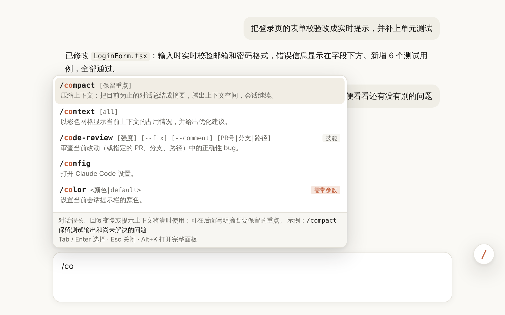
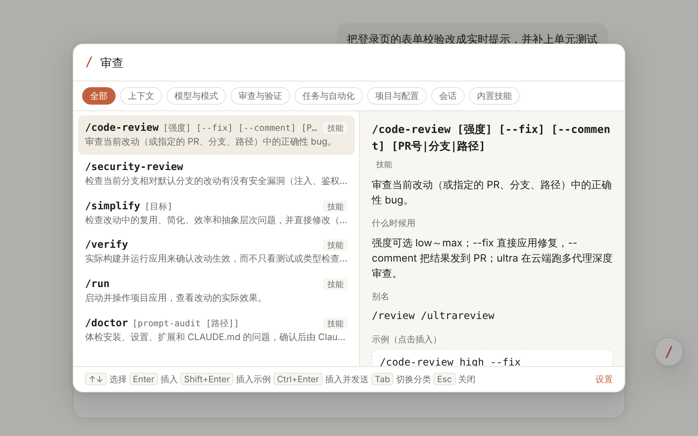
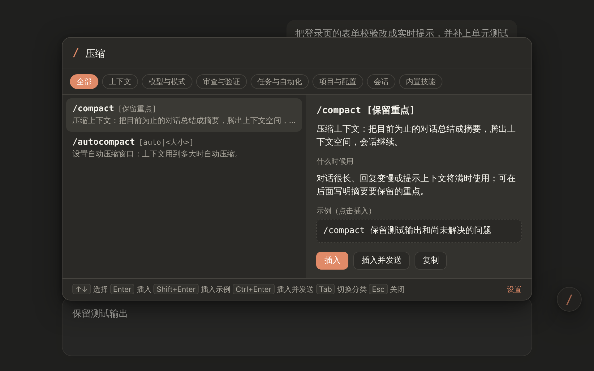
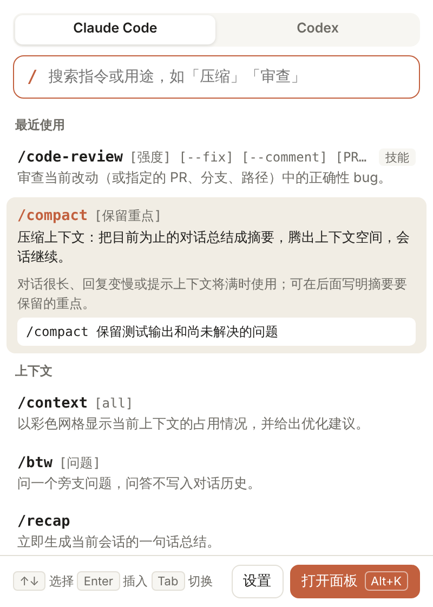
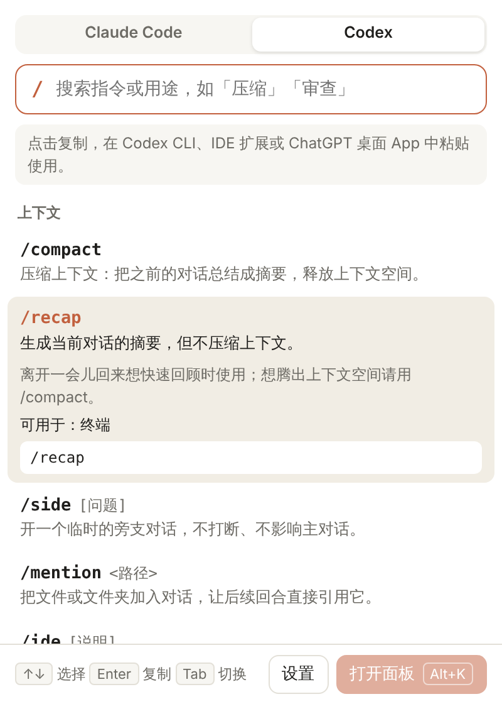
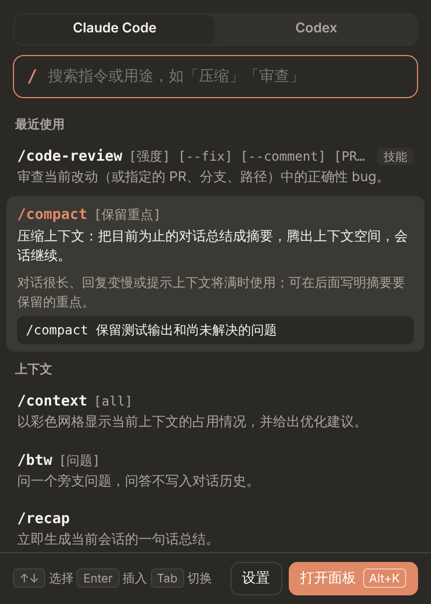
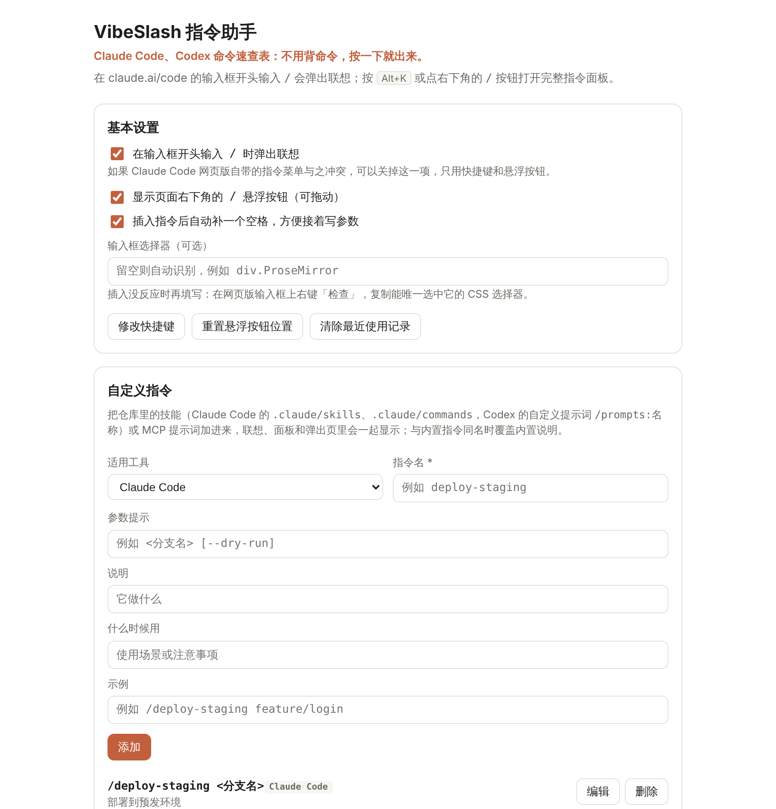
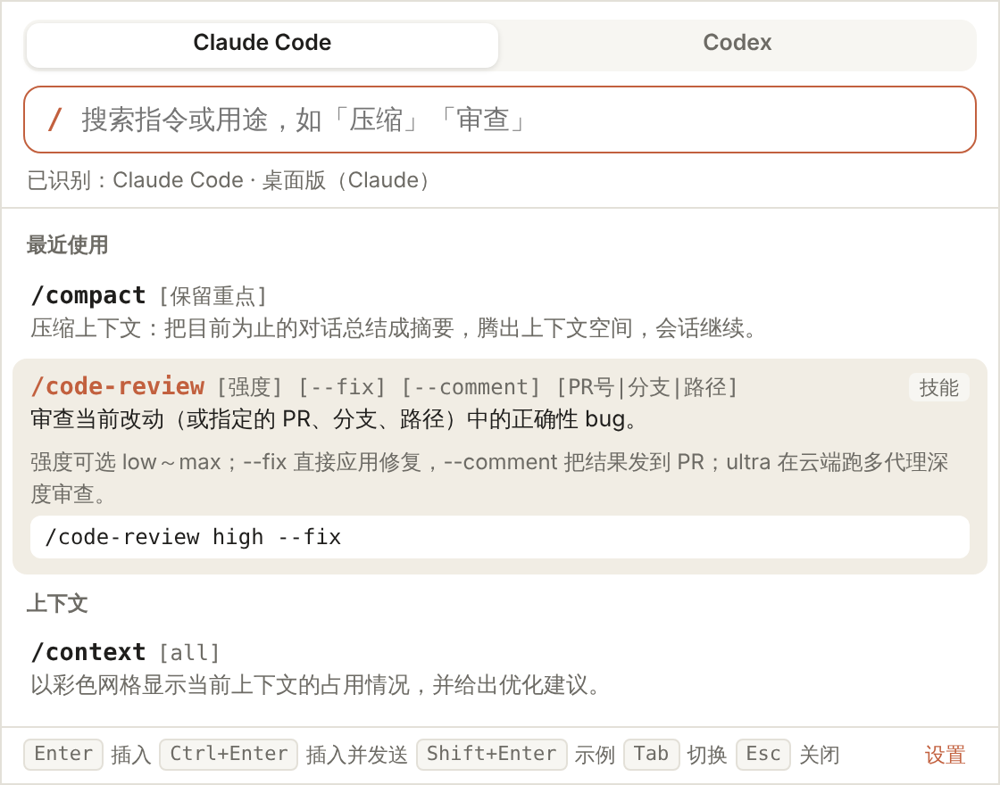
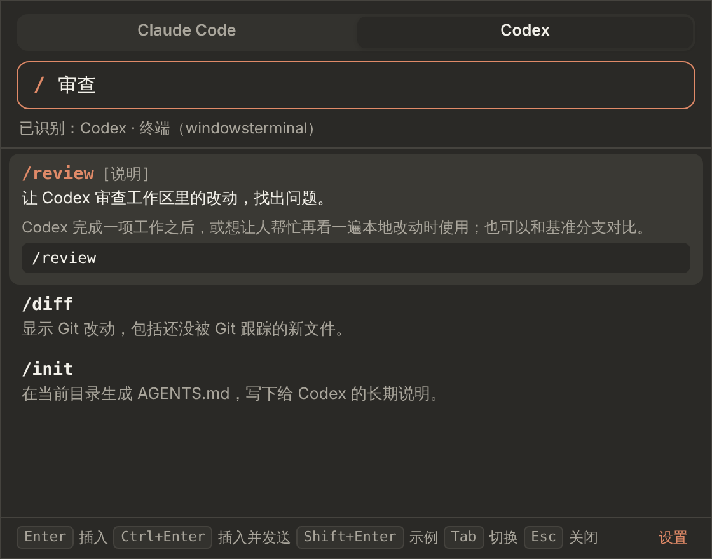

# VibeSlash コマンドアシスタント

[简体中文](README.md) · [English](README.en.md) · **日本語** · [한국어](README.ko.md)

**Claude Code・Codex のコマンド早見表。覚えなくていい、ワンキーで出てくる。**

**VibeSlash** は、Claude Code と Codex のスラッシュコマンド（slash commands）を中国語で解説する、無料・オープンソースのアシスタントです。Chrome / Edge のブラウザ拡張機能と、Windows・macOS のデスクトップ版があります。ブラウザ拡張機能を使うと、[Claude Code の Web 版](https://claude.ai/code)でスラッシュコマンドをすばやく入力できます。入力欄の先頭で `/` を打つと中国語の説明付きで候補が表示され、`Alt+K` を押すとコマンドパレットが開きます。どのコマンドにも説明・使いどころ・例と、Web 版での注意点が付いています。`/compact`、`/context`、`/code-review` の使い方を覚えていなくても大丈夫です。「压缩」（圧縮）、「上下文」（コンテキスト）、「审查」（レビュー）のように中国語の用途で検索すれば見つかりますし、`comp` のようにコマンド名の一部を打つあいまい検索も使えます。

ブラウザのツールバーにある拡張機能のアイコンをクリックすると、**OpenAI Codex** と **DeepSeek Harness** のスラッシュコマンドもすべて確認できます。Codex の各コマンドについては、Codex CLI、IDE 拡張機能、ChatGPT デスクトップアプリのどこで使えるかも表示します。

**デスクトップ版**（プレビュー）はタスクトレイまたはメニューバーに常駐します。Claude デスクトップアプリ、ChatGPT デスクトップアプリの Codex モード、またはターミナルで実行中の `claude` / `codex` で `Alt + /`（macOS は `⌥ /`）を押すと、入力欄の横にコマンドパレットが開きます。使っているツールを自動で判別し、選んだコマンドをそのまま入力します。デスクトップアプリでは、ブラウザ拡張機能と同じように入力欄の先頭で `/` を打つか、画面上の `/` フローティングボタンをクリックしても開けます。

> 🪶 **気にならないほど軽い**：ブラウザ拡張機能はわずか **52 KB**、Windows 版インストーラーは **1.3 MB**、macOS 版インストーラーは **1 MB** です。.NET や Java、Node.js は不要で、数秒でダウンロードしてすぐに使えます。

[**⬇ ダウンロード**](https://github.com/joygogogo163/claudetools/releases) · [インストール方法](#インストール) · [デスクトップ版](#デスクトップ版windows--macos) · [コマンド一覧](#コマンド一覧) · [よくある質問](#よくある質問) · [公式サイト](https://joygogogo163.github.io/claudetools/ja/)

## 目次

- [機能](#機能)
- [スクリーンショット](#スクリーンショット)
- [デスクトップ版（Windows / macOS）](#デスクトップ版windows--macos)
- [インストール](#インストール)
- [コマンド一覧](#コマンド一覧)
  - [Claude Code コマンド一覧](#claude-code-コマンド一覧)
  - [Codex コマンド一覧](#codex-コマンド一覧)
  - [DeepSeek コマンド一覧](#deepseek-コマンド一覧)
- [よくある質問](#よくある質問)
- [ロードマップ](#ロードマップ)
- [商標について](#商標について)

## 機能

- **`/` を打つだけで候補を表示**：メッセージの先頭で `/` を入力すると、入力欄の上に一致するコマンドが並びます。`↑↓` で選択、`Tab` / `Enter` で確定、`Esc` で閉じます。
- **コマンドを検索**：コマンド名や別名のあいまい検索（`comp` で `/compact` など）に加え、中国語の用途でも検索できます。たとえば「压缩」（圧縮）で `/compact`、「审查」（レビュー）で `/code-review` と `/security-review` が見つかります。
- **中国語 IME に対応**：中国語 IME で `/` キーを押したときに入力される `、` や全角の `／` でも候補が表示され、確定すると半角の `/` に置き換わります。
- **コマンドパレット**：`Alt+K` か右下の `/` フローティングボタンで開き、カテゴリ別に閲覧できます。右側には引数・使い方・例と Web 版での注意点を表示します。`Ctrl+Enter` で入力して送信、`Shift+Enter` で例を入力します。
- **Web 版での注意点**：Web 版では引数が必要なコマンド（`/model`、`/effort` など）や使えないコマンド（`/clear` など）に印を付け、つまずきを防ぎます。
- **最近使ったコマンド**：よく使うコマンドが自動で先頭に並びます。
- **カスタムコマンド**：リポジトリのスキル（`.claude/skills`）やコマンド（`.claude/commands`）、チームで決めた指示を追加できます。JSON でのインポート／エクスポートに対応し、ブラウザのアカウントで同期されます。
- **ダークモード**：ページに合わせて自動で切り替わります。
- **Codex・DeepSeek コマンドの早見表**：ツールバーのポップアップで Claude Code、Codex、DeepSeek を切り替えられます（`Tab` キー）。Codex や DeepSeek Harness のページを開いているときは自動で切り替わり、Codex の各コマンドが使える環境（ターミナル、IDE、デスクトップ版）も表示します。
- **軽量**：拡張機能は 52 KB、デスクトップ版のインストーラーは約 1 MB で、追加のランタイムは不要です。
- **プライバシーに配慮**：通信は一切行わず、会話履歴も読みません。すべて手元で動作します。

## スクリーンショット

> アプリの画面は現在中国語です。コマンドの説明は [Web サイト](https://joygogogo163.github.io/claudetools/ja/)で日本語でも読めます。

**コマンドパレット**：「审查」（中国語で「レビュー」）で検索した様子。右側に使い方、別名、例が表示されます

**ダークモード**：入力欄にすでに文字があるときは、コマンドが先頭に挿入され、元の文字はその引数になります

**ツールバーのポップアップ**：拡張機能のアイコンをクリックすると全コマンドを確認でき、Claude Code と Codex を切り替えられます。ほかの Web ページではクリックするとコピーされます

| Claude Code | Codex | ダークモード |
| :-: | :-: | :-: |
|  |  |  |

**設定ページ**：候補表示とフローティングボタンのオン／オフ、Claude Code や Codex へのカスタムコマンドの追加ができます

## デスクトップ版（Windows / macOS）

デスクトップ版はブラウザに依存せず、デスクトップアプリやターミナルでコマンドパレットを呼び出せます。開き方は 3 通りあります。ショートカットキー（`Alt + /`、macOS は `⌥ /`）を押す、デスクトップアプリの入力欄の先頭で `/` を打つ、画面上の `/` フローティングボタンをクリックする、のいずれかです。

| 前面にあるのは… | 判別結果 | 表示するコマンド |
| :- | :- | :- |
| Claude デスクトップアプリ（Code タブ） | Claude Code · デスクトップ版 | デスクトップ版で使える Claude Code コマンド。引数が必要なものには印を付けます |
| ChatGPT デスクトップアプリ（Codex モード） | Codex · デスクトップ版 | デスクトップアプリが対応している Codex コマンド |
| DeepSeek Harness デスクトップアプリ | DeepSeek · デスクトップ版 | DeepSeek Harness のコマンド |
| ターミナルで実行中の `claude` / `codex` | Claude Code / Codex · ターミナル | ターミナルの子プロセスとウィンドウタイトルから判別 |
| VS Code、Cursor、JetBrains などのエディター | 同上。エディター内の Codex は IDE 拡張機能として扱います | IDE 拡張機能が対応している Codex コマンド |
| 判別できないウィンドウ | 前回使ったツール | 全コマンド（`Tab` で切り替え可能） |

- **`/` を打つだけで開く**：ブラウザ拡張機能と同じように、Claude、ChatGPT、DeepSeek Harness のデスクトップアプリで入力欄の先頭に `/` を打つと（中国語 IME で入力される `、` も含む）、コマンドパレットがすぐに開きます。続けて打った文字は検索語になります。コマンドを選ぶと先ほどの `/` は自動で削除され、`Esc` を押した場合は残ります。ターミナルの Claude Code や Codex には独自のコマンドメニューがあるため、この機能はデスクトップアプリでのみ働きます。設定でオフにすることもできます。
- **フローティングボタン**：フォーカスを奪わない小さな丸い `/` ボタンが画面上に表示されます。クリックでコマンドパレットが開き、長押しして好きな位置にドラッグでき（位置は記憶されます）、右クリックで設定を開きます。表示方法は「自動」（Claude、ChatGPT、DeepSeek Harness のデスクトップアプリが前面にあるときに表示。既定）、「常に表示」、「表示しない」から選べます。
- **入力欄のすぐ横に表示**：入力欄の位置を読み取り（Windows は UI Automation、macOS はアクセシビリティ API を使用）、できるだけ入力欄の上にパレットを表示します。
- **選ぶだけで入力**：`Enter` で入力、`Ctrl+Enter`（macOS は `⌘↩`）で入力して送信、`Shift+Enter` で例を入力します。既定ではクリップボード経由で貼り付け、完了後に元のクリップボードの内容を復元します。1 文字ずつ入力する方式に切り替えることもできます。
- **軽量**：インストーラーは約 1 MB で、数秒でダウンロードできます。Windows 版は Rust で書かれており、画面にはシステム標準の WebView2 を使います。macOS 版はネイティブの Swift アプリ（AppKit + SwiftUI）です。どちらも .NET、Java、Node.js などのランタイムは不要で、Electron アプリのようにブラウザエンジンを丸ごと同梱することもありません（そうしたアプリのインストーラーは 100 MB を超えることもよくあります）。

| ダウンロード | サイズ |
| :- | :-: |
| ブラウザ拡張機能（Chrome / Edge） | **52 KB** |
| Windows 版インストーラー（`setup.exe`） | **1.3 MB** |
| Windows 版ポータブル（`portable.zip`、展開するだけで使えます） | **1.6 MB** |
| macOS 版インストーラー（`.dmg`、Apple シリコンと Intel の両方に対応） | **1.0 MB** |

サイズは Releases にある拡張機能 v1.1.1、デスクトップ版 v0.1.0 のファイルにもとづいています。

| Windows：Claude デスクトップアプリを判別 | Windows：ターミナルの Codex を判別（ダークモード） |
| :-: | :-: |
|  |  |

> デスクトップ版はまだプレビュー版で、インストーラーには署名していません。macOS 版で入力欄の位置を読み取り、`/` の入力を検知し、コマンドを入力するには「アクセシビリティ」の許可が必要です。許可していない場合、選んだコマンドはクリップボードにコピーされるだけです。`/` を打って開く機能は、押されたキーがスラッシュかどうかを判定するだけで、キー入力の内容を記録・送信することは一切ありません。

## インストール

### ブラウザ拡張機能

1. [Releases](https://github.com/joygogogo163/claudetools/releases/latest) から最新の `vibeslash-extension-v*.zip` をダウンロードし、決まったフォルダーに展開します（展開後は削除や移動をしないでください）。
2. `chrome://extensions`（Edge は `edge://extensions`）を開き、右上の「デベロッパー モード」をオンにします。
3. 「パッケージ化されていない拡張機能を読み込む」をクリックし、展開したフォルダー（直下に `manifest.json` があるフォルダー）を選びます。
4. 開いている claude.ai/code のページを再読み込みし、入力欄で `/` を打ってみてください。

アップデートするときは、新しいバージョンを元のフォルダーに上書きで展開し、拡張機能の管理ページで再読み込みボタンを押してから、claude.ai のページを再読み込みします。詳しい説明（カスタムコマンドの JSON 形式、開発とテスト）は[拡張機能のドキュメント](apps/extension/README.md)をご覧ください。

### Windows 版

[Releases](https://github.com/joygogogo163/claudetools/releases/latest) から `VibeSlash-*-windows-x64-setup.exe` をダウンロードしてインストールします（または portable.zip をダウンロードし、展開してそのまま実行します）。起動するとタスクトレイに常駐します。既定のショートカットキーは `Alt + /` で、設定で変更できます。「不明な発行元」と表示された場合は「詳細情報」→「実行」をクリックしてください。

### macOS 版

[Releases](https://github.com/joygogogo163/claudetools/releases/latest) から `VibeSlash-*-macos.dmg` をダウンロードし、VibeSlash を「アプリケーション」フォルダーにドラッグします。初めて開くときは「アプリケーション」で VibeSlash を右クリックして「開く」を選び、案内に従って「システム設定 › プライバシーとセキュリティ › アクセシビリティ」で VibeSlash を許可してください。起動するとメニューバーに常駐します。既定のショートカットキーは `⌥ /` です。macOS 14 以降が必要です。

## コマンド一覧

以下の表は VibeSlash のコマンドデータから自動生成しており、拡張機能に表示される内容と同じです。

### Claude Code コマンド一覧

VibeSlash が収録している Claude Code のスラッシュコマンドをカテゴリ別にまとめました。Web 版（クラウドセッション）で意味のあるコマンドだけを収録しています。公式ドキュメントの [Commands](https://code.claude.com/docs/en/commands) と [Use Claude Code in the cloud](https://code.claude.com/docs/en/claude-code-on-the-web) にもとづいています。実際に使えるかどうかはアカウントのプラン、Claude Code のバージョン、組織のポリシーにもよります。セッションで `/help` を送ると、いま使えるコマンドを確認できます。

<!-- commands:claude-code:start -->
<!-- scripts/readme.ts で生成。手で編集しないでください -->

#### コンテキスト

| コマンド | 働き | 備考 |
| :- | :- | :- |
| `/compact [残したい要点]` | コンテキストを圧縮します。これまでの会話を要約してコンテキストを空け、セッションはそのまま続きます。 |  |
| `/context [all]` | 現在のコンテキスト使用状況をカラーグリッドで表示し、最適化の提案を示します。 |  |
| `/btw [質問]` | 本筋から外れた質問をします。質問と回答は会話履歴に残りません。 |  |
| `/recap` | 現在のセッションの一文要約をすぐに生成します。 |  |
| `/autocompact [auto\|<サイズ>]` | 自動圧縮ウィンドウを設定します。コンテキストがどれだけ使われたら自動圧縮するかを決めます。 |  |
| `/clear [名前]` | コンテキストが空の新しい会話を始めます。 | Web 版では使用不可; 別名 `/reset` `/new` |

#### モデルとモード

| コマンド | 働き | 備考 |
| :- | :- | :- |
| `/model <モデル>` | モデルを切り替えます。 | Web 版では引数が必要 |
| `/effort <low\|medium\|high\|xhigh\|max\|auto>` | 推論の強度を調整します。status で現在の値を確認し、ultracode on/off で ultracode を切り替えます。 | Web 版では引数が必要 |
| `/fast [on\|off]` | 高速モードをオン／オフし、出力を速くします。 |  |
| `/plan [タスクの説明]` | プランモードに入ります。まず分析して方針を示し、確認してからコードを変更します。 |  |
| `/advisor [モデル\|off]` | アドバイザーツールをオン／オフします。重要な場面で 2 つ目のモデルに意見を求めます。 | Web 版では引数が必要 |
| `/goal [完了条件\|clear]` | 目標を設定します。Claude は条件が満たされるまで複数ターンにわたって作業を続けます。 |  |
| `/output-style [スタイル]` | 出力スタイルを一覧表示または切り替えます。 |  |

#### レビューと検証

| コマンド | 働き | 備考 |
| :- | :- | :- |
| `/code-review [強度] [--fix] [--comment] [PR番号\|ブランチ\|パス]` | 現在の変更（または指定した PR、ブランチ、パス）に含まれる正確性のバグをレビューします。 | 組み込みスキル; 別名 `/review` `/ultrareview` |
| `/security-review` | デフォルトブランチに対する現在のブランチの変更にセキュリティ脆弱性（インジェクション、認証、データ漏えいなど）がないか確認します。 |  |
| `/simplify [対象]` | 変更内の再利用、簡素化、効率、抽象度の問題を確認し、直接修正します（バグは探しません）。 | 組み込みスキル |
| `/verify` | テストや型チェックだけでなく、アプリを実際にビルドして実行し、変更が効いていることを確認します。 | 組み込みスキル |
| `/run` | プロジェクトのアプリを起動・操作し、変更の実際の効果を確認します。 | 組み込みスキル |

#### タスクと自動化

| コマンド | 働き | 備考 |
| :- | :- | :- |
| `/loop [間隔] [プロンプト]` | セッションが続いている間、一定間隔でプロンプトを繰り返し実行します。間隔を省略すると Claude が自分でペースを決めます。 | 組み込みスキル; 別名 `/proactive` |
| `/batch <指示>` | 大規模な並列変更を行います。5～30 個の独立した単位に分割し、それぞれをバックグラウンドのサブエージェントが独立した worktree で処理します。 | 組み込みスキル |
| `/subtask <タスク>` | 会話全体を引き継いだバックグラウンドのサブエージェントを派遣して脇道のタスクを処理させ、完了すると結果が現在の会話に戻ります。 |  |
| `/schedule [説明]` | クラウドで実行するスケジュールタスク（Routines）を作成、変更、一覧表示、実行します。 | 別名 `/routines` |
| `/tasks` | 現在のセッションのバックグラウンドタスク（完了したサブエージェントを含む）を表示・管理します。 | 別名 `/bashes` |
| `/deep-research <質問>` | Web を並列に検索して情報源を照合し、引用付きの調査レポートを出力します。 | 組み込みワークフロー |

#### プロジェクトと設定

| コマンド | 働き | 備考 |
| :- | :- | :- |
| `/init` | プロジェクトを分析し、最初の CLAUDE.md プロジェクトガイドを生成します。 |  |
| `/update-config [要望]` | 設定の変更内容（あるコマンドの許可、環境変数の設定、hook の追加など）を自然言語で伝えると、Claude が settings.json を修正します。 | 組み込みスキル |
| `/fewer-permission-prompts` | 履歴によく出てくる読み取り専用コマンドを洗い出し、プロジェクトの .claude/settings.json の許可リストに追加します。 | 組み込みスキル |
| `/doctor [prompt-audit [パス]]` | インストール、設定、拡張機能、CLAUDE.md の問題を診断し、確認後に Claude が修正します。 | 組み込みスキル; 別名 `/checkup` |
| `/debug [問題の説明]` | 現在のセッションでデバッグログを有効にし、ログを読んで問題を調査します。 | 組み込みスキル |
| `/reload-skills` | スキルとコマンドのディレクトリを再スキャンし、セッション中に追加・変更したスキルをすぐに使えるようにします。 |  |
| `/mcp [reconnect\|enable\|disable <サーバー\|all>]` | MCP サーバーの接続と認証を管理します。 |  |
| `/config` | Claude Code の設定を開きます。 | 別名 `/settings` |

#### セッション

| コマンド | 働き | 備考 |
| :- | :- | :- |
| `/rename <名前>` | 現在のセッションの名前を変更します。 | Web 版では引数が必要 |
| `/color <色\|default>` | 現在のセッションのプロンプトバーの色を設定します。 | Web 版では引数が必要 |
| `/usage` | このセッションのコスト、プランの使用量、アクティビティの統計を表示します。 | 別名 `/cost` `/stats` |
| `/teleport` | claude --teleport <セッションID> コマンドを表示します。これを使うとローカルのターミナルでこのクラウドセッションを引き継げます。 | 別名 `/tp` |
| `/export [ファイル名]` | 現在の会話をプレーンテキストとしてエクスポートします。ファイル名を指定するとそのファイルに直接書き込みます。 |  |
| `/help` | ヘルプと利用可能なコマンドを表示します。 |  |

#### 組み込みスキル

| コマンド | 働き | 備考 |
| :- | :- | :- |
| `/claude-api [サブコマンド]` | Claude API と Managed Agents のリファレンス（モデル、SDK の使い方、キャッシュなど）を読み込みます。 | 組み込みスキル |
| `/dataviz [要望]` | グラフとダッシュボードのデザインガイドです。グラフの形式を選び、役割に応じて配色し、色覚多様性への配慮とコントラストを検証します。 | 組み込みスキル |
| `/design [要望]` | 画面のラフ、ページフロー、ポスターを編集可能な Claude Design のキャンバスとして描きます。 | 組み込みスキル |
| `/slides [要望]` | 簡単な説明から Claude Slides のプレゼンテーションを生成します。 | 組み込みスキル |

<!-- commands:claude-code:end -->

### Codex コマンド一覧

OpenAI Codex のスラッシュコマンドです。公式ドキュメントの [Developer commands](https://learn.chatgpt.com/docs/developer-commands) と [Slash commands](https://learn.chatgpt.com/docs/reference/slash-commands) にもとづいています。Codex のコマンドが使えるのは、ターミナルの Codex CLI、IDE 拡張機能、ChatGPT デスクトップアプリの Codex モードの 3 か所で、それぞれ対応するコマンドが少しずつ異なります。一部の環境でしか使えないコマンドは備考欄に記載しています。一部のコマンド（`/plan`、`/goal`、`/fast` など）は、アカウント、モデル、機能フラグにも左右されます。ChatGPT の Web 版には独自のコマンドメニューがあり、これらのコマンドは使えません。

<!-- commands:codex:start -->
<!-- scripts/readme.ts で生成。手で編集しないでください -->

#### コンテキスト

| コマンド | 働き | 備考 |
| :- | :- | :- |
| `/compact` | コンテキストを圧縮します。これまでの会話を要約し、コンテキストの空きを確保します。 |  |
| `/recap` | 現在の会話の要約を生成しますが、コンテキストは圧縮しません。 | ターミナルのみ |
| `/side [質問]` | 一時的な脇道の会話を開きます。メインの会話を中断せず、影響も与えません。 | 別名 `/btw` |
| `/mention <パス>` | ファイルやフォルダーを会話に追加し、以降のターンで直接参照できるようにします。 | ターミナルのみ |
| `/ide [説明]` | エディターで開いているファイルや現在の選択範囲などのコンテキストを、次のプロンプトに含めます。 | ターミナルのみ |
| `/ide-context` | IDE コンテキストの自動添付をオン／オフします。 | デスクトップ版・IDEのみ |
| `/memories` | 既存のメモリを使うかどうか、新しいメモリを生成するかどうかを設定します。 |  |

#### モデルと権限

| コマンド | 働き | 備考 |
| :- | :- | :- |
| `/model` | 現在使うモデル（と推論の強度）を選びます。 |  |
| `/reasoning` | 現在の会話の推論の強度を選びます。 | デスクトップ版・IDEのみ |
| `/fast` | 現在のモデルの Fast モードをオン／オフします。選択は保存されます。 |  |
| `/personality` | Codex の応答スタイルを選びます。 | デスクトップ版・IDEのみ |
| `/plan [プロンプト]` | プランモードに切り替えます。最初の計画依頼を一緒に付けることもできます。 |  |
| `/goal [目標\|edit\|pause\|resume\|clear]` | タスクの目標を設定、確認、変更、一時停止、再開、またはクリアします。 |  |
| `/permissions` | Codex が確認なしで直接実行できる操作を設定します。 | ターミナルのみ |
| `/approve` | 自動レビューが直近で拒否した操作を承認し、1 回だけ再試行させます。 |  |
| `/experimental` | ネットワークプロキシや実行中のスリープ防止など、実験的な機能をオン／オフします。 | ターミナルのみ |

#### レビューと変更

| コマンド | 働き | 備考 |
| :- | :- | :- |
| `/review [説明]` | ワークスペース内の変更を Codex にレビューさせ、問題を見つけます。 |  |
| `/diff` | まだ Git で追跡されていない新しいファイルも含めて、Git の変更を表示します。 | ターミナルのみ |
| `/init` | 現在のディレクトリに AGENTS.md を生成し、Codex 向けの長期的な指示を書き込みます。 |  |

#### ワークスペースと実行場所

| コマンド | 働き | 備考 |
| :- | :- | :- |
| `/worktree` | 新しい Git worktree で会話を開始または継続します。 |  |
| `/local` | 会話をローカルのワークスペースで実行します。 | デスクトップ版・IDEのみ |
| `/cloud` | 会話をクラウドで実行します。 | デスクトップ版・IDEのみ |
| `/cloud-environment` | この会話で使うクラウド環境を選びます。 | デスクトップ版・IDEのみ |
| `/project` | 新しい会話が属するプロジェクトを選びます。 | デスクトップ版・IDEのみ |
| `/cd [パス]` | セッションの作業ディレクトリを切り替えます。パスを省略するとホームディレクトリに移動します。 | ターミナルのみ |
| `/pwd` | 現在のセッションの作業ディレクトリを表示します。 | ターミナルのみ; 別名 `/cwd` |

#### セッション

| コマンド | 働き | 備考 |
| :- | :- | :- |
| `/new [名前]` | 新しい会話を始めます。名前を付けることもできます。 | デスクトップ版・ターミナルのみ |
| `/clear [名前]` | ターミナルをクリアして新しい会話を始めます。 | ターミナルのみ |
| `/rename [名前]` | 現在の会話の名前を変更します。 | デスクトップ版・ターミナルのみ |
| `/fork` | 現在の会話を新しい会話として複製します。 |  |
| `/resume` | セッション一覧から、以前保存した会話を再開します。 | ターミナルのみ |
| `/archive` | 現在のセッションをアーカイブします。セッション一覧からは外れますが、記録は残ります。 | デスクトップ版・ターミナルのみ |
| `/delete` | 現在のセッションと、そこから派生したサブセッションを完全に削除します。 | ターミナルのみ |
| `/agents` | エージェントのコマンドセンターを開き、会話を閲覧したりエージェント間を切り替えたりします。 | ターミナルのみ |
| `/subagents` | 現在のセッションのサブエージェントのスレッドに切り替えます。 | ターミナルのみ |
| `/copy` | Codex の直近の完全な応答をコピーします。 | ターミナルのみ |
| `/export [ファイル名]` | 会話全体を Markdown としてエクスポートし、クリップボードにコピーするかファイルに保存します。 | ターミナルのみ |
| `/app` | ChatGPT デスクトップアプリで現在のセッションを続けます。 | ターミナルのみ |
| `/quit` | Codex CLI を終了します。 | ターミナルのみ; 別名 `/exit` |

#### スキルと拡張

| コマンド | 働き | 備考 |
| :- | :- | :- |
| `/skills` | スキルを閲覧して使用し、スキルの指示に従って Codex に特定のタスクをこなさせます。 | ターミナルのみ |
| `/mcp [verbose\|login <名前>]` | 設定済みの MCP ツールと接続状態を表示します。 |  |
| `/apps` | アプリ（コネクタ）を閲覧し、プロンプトに挿入します。 | ターミナルのみ |
| `/plugins` | インストール済みおよびインストール可能なプラグインを閲覧します。 | ターミナルのみ |
| `/hooks` | ライフサイクルフックを表示・管理します。 | ターミナルのみ |
| `/import` | Claude Code または Cursor から設定、プロジェクトファイル、最近の会話をインポートします。 | ターミナルのみ |
| `/ps` | バックグラウンドターミナルとその最新の出力を一覧表示します。 | ターミナルのみ |
| `/stop` | 現在のセッションのバックグラウンドターミナルをすべて停止します。 | ターミナルのみ; 別名 `/clean` |

#### 設定と診断

| コマンド | 働き | 備考 |
| :- | :- | :- |
| `/status` | セッションの設定と使用量（現在のモデル、承認ポリシー、書き込み可能なディレクトリ、残りのコンテキストなど）を表示します。 |  |
| `/usage [daily\|weekly\|cumulative]` | アカウントの token 使用量を表示するか、利用枠のリセットを 1 回使用します。 | デスクトップ版・ターミナルのみ |
| `/statusline` | 下部のステータスバーに表示する情報と、その順序を設定します。 | ターミナルのみ |
| `/title` | ターミナルのウィンドウやタブのタイトルに表示する情報を設定します。 | ターミナルのみ |
| `/theme` | コードのハイライトテーマを選びます。プレビューしてから保存できます。 | ターミナルのみ |
| `/pet [off]` | 画面に表示される小さなペットを選ぶか、非表示にします。 | デスクトップ版・ターミナルのみ; 別名 `/pets` |
| `/tui` | 次回起動時のターミナルモード（スクロールバックまたはフルスクリーン）を選びます。 | ターミナルのみ |
| `/vim` | 入力欄の Vim モードをオン／オフします。 | ターミナルのみ |
| `/keymap` | TUI のショートカットキーを確認・変更し、config.toml に保存します。 | ターミナルのみ |
| `/raw [on\|off]` | 生のスクロールモードをオン／オフし、ターミナルでの選択やコピーをしやすくします。 | ターミナルのみ |
| `/debug-config` | 設定の階層とポリシーの出どころを出力し、設定が反映されない原因を調べます。 | ターミナルのみ |
| `/daemon` | ローカルのバックグラウンドサービスの管理画面を開きます。 | ターミナルのみ |
| `/warnings` | セッション中に保持された警告と診断情報を表示します。 | ターミナルのみ |
| `/setup-default-sandbox` | Windows で昇格したエージェントサンドボックスを設定します。 | ターミナルのみ |
| `/feedback` | Codex チームにフィードバックを送信します。ログを添付することもできます。 |  |
| `/logout` | Codex からログアウトし、ローカルの認証情報を消去します。 | ターミナルのみ |

<!-- commands:codex:end -->

### DeepSeek コマンド一覧

DeepSeek の公式エージェント [DeepSeek Harness](https://github.com/deepseek-ai/deepseek-harness)（`dsh`）の組み込みスラッシュコマンドです。公式リポジトリの[コマンドのドキュメント](https://github.com/deepseek-ai/deepseek-harness/blob/master/docs/subsystems/commands.md)とソースコードにもとづいています。コマンドは Harness の Web UI（`npx @deepseek-ai/dsh web`、既定は <http://127.0.0.1:3080>）またはデスクトップアプリの入力欄で入力します。コマンドラインモードにはコマンドメニューがありません。`.dsh/skills` に置いたスキルも `/スキル名` としてメニューに表示されます。Harness はまだ開発者プレビューのため、コマンドはバージョンによって増減することがあります。

DeepSeek のドキュメントに沿って Claude Code を DeepSeek の API で使っている場合は、Claude Code のコマンドを使うことになるので、上の [Claude Code コマンド一覧](#claude-code-コマンド一覧)をご覧ください。

<!-- commands:deepseek:start -->
<!-- scripts/readme.ts で生成。手で編集しないでください -->

#### モードと権限

| コマンド | 働き | 備考 |
| :- | :- | :- |
| `/plan [off\|メッセージ]` | プランモードに入る／抜けます。まず計画を示し、確認してから変更します。 |  |
| `/goal [目標\|clear\|edit <目標>\|pause\|resume]` | 長時間タスクの目標を設定・表示します。Harness は目標に向けて作業を続けます。 |  |
| `/permission <プリセット>` | 権限プリセット（サンドボックスモードと承認ポリシー）を切り替えます。 |  |

#### コンテキスト

| コマンド | 働き | 備考 |
| :- | :- | :- |
| `/compact` | 古い会話履歴を圧縮してコンテキストの空きを確保します。 |  |

#### セッション

| コマンド | 働き | 備考 |
| :- | :- | :- |
| `/export` | このセッションのログを ZIP でダウンロードします。 |  |
| `/feedback <内容>` | このセッションについてのフィードバックを記録します。 |  |

<!-- commands:deepseek:end -->

## よくある質問

### Claude Code の Web 版でスラッシュコマンドは使えますか？

使えます。クラウドセッションでは、テキストを出力する組み込みコマンドの大半（`/compact`、`/context`、`/code-review` など）を実行できます。ターミナルの画面でしか動かないコマンド（`/plugin`、`/resume`、`/theme` など）は Web 版では使えないため、VibeSlash にも収録していません。

### `/compact` と `/clear` の違いは？

`/compact` はこれまでの会話を要約してコンテキストを空け、セッションを続けます。`/clear` はコンテキストが空の新しい会話を始めます。Web 版は `/clear` に対応していないため、最初からやり直したいときはサイドバーから新しいセッションを作成してください。

### `/model` や `/effort` を Web 版で打っても選択画面が出ないのはなぜ？

Web 版ではターミナルの対話式の選択画面が表示されないため、`/model opus` や `/effort high` のように引数を直接指定する必要があります。VibeSlash ではこうしたコマンドに「引数が必要」と表示し、例も示しています。

### 入力しても反応しない、または「クリップボードにコピーしました」と表示される

拡張機能は、ページ下部に表示されている入力欄を自動で見つけます。Web ページのデザイン変更などで見つけられなくなった場合は、入力欄を右クリックして「検証」を選び、その入力欄だけを一意に選択できる CSS セレクターを設定ページの「输入框选择器」（入力欄セレクター）に入力してください。

### Web 版に組み込まれたコマンドメニューと競合する場合は？

設定ページで「在输入框开头输入 / 时弹出联想」（入力欄の先頭で / を打ったときに候補を表示）をオフにし、`Alt+K` とフローティングボタンだけを使ってください。

### Codex に対応していますか？

早見表として対応しています。拡張機能のアイコンをクリックし、ポップアップで Codex に切り替える（または `Tab` を押す）と、Codex のスラッシュコマンドをすべて検索できます。クリックしてコピーし、Codex CLI、IDE 拡張機能、ChatGPT デスクトップアプリに貼り付けてください。Codex のコマンドは ChatGPT の Web 版では使えないため、拡張機能が Web ページに Codex のコマンドを入力することはありません。ChatGPT デスクトップアプリやターミナルでコマンドパレットを直接呼び出したい場合は、[デスクトップ版](#デスクトップ版windows--macos)をお使いください。

### DeepSeek に対応していますか？

対応しています。DeepSeek の公式エージェント DeepSeek Harness には `/plan`、`/goal`、`/compact` などのスラッシュコマンドがあり、VibeSlash はその中国語の説明を収録しています（[DeepSeek コマンド一覧](#deepseek-コマンド一覧)を参照）。デスクトップ版は DeepSeek Harness デスクトップアプリを判別できます。ブラウザ拡張機能のポップアップでも確認でき、手元の PC で Harness の Web UI（既定のポートは 3080）を開いているときは自動で DeepSeek に切り替わります。Claude Code を DeepSeek の API で使っている場合は、Claude Code のコマンドを使うことになります。

### データは収集されますか？

いいえ。拡張機能のコンテンツスクリプトは `https://claude.ai/*` でのみ動作し、通信は一切行わず、会話履歴も読みません。ポップアップは、拡張機能のアイコンをクリックしたときにだけ現在のタブの URL を読み取り、どのツールのページかを判別します。設定とカスタムコマンドはブラウザ自身のストレージに保存されます。

### Firefox / Safari に対応していますか？

現在対応しているのは Chrome、Edge などの Chromium 系ブラウザ（Manifest V3）です。Firefox と Safari にはまだ対応していません。

## ロードマップ

- [x] Chrome / Edge 拡張機能：Claude Code Web 版でのコマンド候補表示とコマンドパレット
- [x] Codex スラッシュコマンドの中国語の説明と、ポップアップでの早見表
- [x] デスクトップ版プレビュー（Windows / macOS）：Claude デスクトップアプリ、ChatGPT デスクトップアプリの Codex モード、ターミナルでショートカットキーからコマンドパレットを呼び出し、使っているクライアントを自動判別
- [x] [公式サイト](https://joygogogo163.github.io/claudetools/ja/)：Claude Code・Codex・DeepSeek コマンド一覧（中文、English、日本語、한국어）
- [x] デスクトップ版：`/` の入力でコマンドパレットを自動表示、ドラッグできるフローティングボタン
- [x] DeepSeek Harness のコマンド早見表とデスクトップアプリの判別
- [ ] デスクトップ版：カスタムコマンド、コード署名、自動アップデート

## 商標について

Claude および Claude Code は Anthropic, PBC の商標です。Codex および ChatGPT は OpenAI の商標です。DeepSeek はその権利者の商標です。VibeSlash は独立した非公式のオープンソースプロジェクトであり、Anthropic、OpenAI、DeepSeek とは一切関係がなく、承認・後援・許諾も受けていません。これらの名称は互換性を説明するためにのみ使用しており、各商標はそれぞれの所有者に帰属します。
