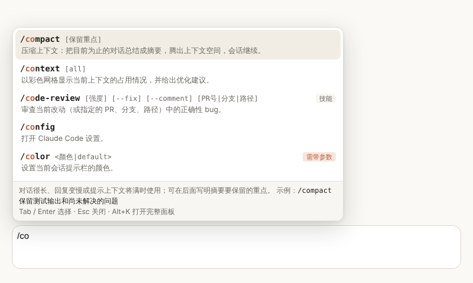
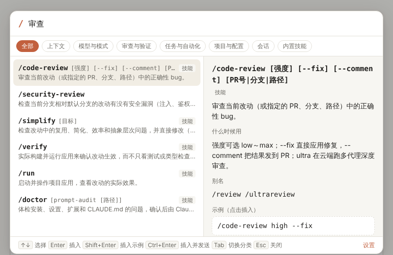

# Claude Code 指令助手

Chrome / Edge 扩展，在 [Claude Code 网页版](https://claude.ai/code)里快速输入 `/` 指令。每条指令都带中文说明、使用场景、示例和网页版的注意事项。



## 功能

- **输入框联想**：在消息开头输入 `/`，输入框上方会列出匹配的指令。按 `↑↓` 选择，`Tab` 或 `Enter` 确认，`Esc` 关闭。指令名已经输全时（如 `/context`），`Enter` 直接发送。
- **中文输入法友好**：中文输入法下按 `/` 打出的 `、` 或 `／` 也能触发联想，选定后自动换成半角 `/`。
- **指令面板**：按 `Alt+K` 或点右下角的 `/` 悬浮按钮打开。可以按指令名、别名或中文用途搜索（比如「压缩」「审查」），也可以按分类浏览；右侧显示参数、用法、示例和网页版注意事项。
  - `Enter` 插入指令；`Shift+Enter` 用示例替换输入框内容；`Ctrl+Enter` 插入并发送；`Tab` 切换分类。
  - 输入框里已经有文字时，指令会加在最前面，原来的文字成为参数，例如「保留测试输出」变成 `/compact 保留测试输出`。开头已经有 `/xxx` 时会替换掉它。
- **网页版注意事项**：`/model`、`/effort`、`/rename`、`/color` 在网页版不会弹出选择器，标为「需带参数」；`/clear` 在网页版不可用，标为「网页版不可用」，并提示改用侧栏新建会话。
- **最近使用**：用过的指令排在列表最前面。
- **自定义指令**：在设置页添加仓库里的技能（`.claude/skills`）、命令（`.claude/commands`）或团队约定的指令，可以导入、导出 JSON。与内置指令同名时，以你的说明为准。
- **工具栏弹出页**：点击扩展图标可以速查全部指令；当前标签页是 Claude Code 时，点击指令会插入到输入框，否则复制到剪贴板。



## 安装

1. 到仓库的 [Releases](https://github.com/joygogogo163/claudetools/releases) 页面下载最新的 `claude-code-slash-helper-v*.zip`，解压到一个固定的目录（之后不要删除或移动它）。
2. 打开 `chrome://extensions`（Edge 为 `edge://extensions`），开启右上角的「开发者模式」。
3. 点「加载已解压的扩展程序」，选择解压出来的目录（里面直接就是 `manifest.json`）。
4. 刷新已经打开的 claude.ai/code 页面。

也可以克隆本仓库，第 3 步直接选择 `claude-code-slash-helper/extension` 目录。

升级时把新版本解压覆盖到原目录，在扩展管理页点这个扩展的刷新按钮，然后刷新 claude.ai 页面。

## 打包

```bash
cd claude-code-slash-helper
npm run pack
```

生成 `dist/claude-code-slash-helper-v<版本号>.zip`，`manifest.json` 在压缩包根目录，可以直接分发，也可以上传到 Chrome 应用商店。打包脚本不依赖第三方包，会先检查 `manifest.json` 和 `package.json` 的版本号是否一致。

GitHub Actions 每次推送都会跑测试并打包，zip 作为构建产物（Artifacts）保存在对应的运行记录里。发布正式版本：

1. 同时修改 `extension/manifest.json` 和 `package.json` 里的 `version`，提交并推送。
2. 推送标签 `slash-helper-v<版本号>`，例如 `git tag slash-helper-v1.0.1 && git push origin slash-helper-v1.0.1`。
3. 工作流会校验标签与版本号一致，然后创建 Release 并附上 zip。

不方便推送标签时，也可以在 Actions 页面手动运行 `claude-code-slash-helper` 工作流并勾选「创建 Release」，工作流会在所选分支的最新提交上创建标签 `slash-helper-v<版本号>` 和 Release。

## 收录的指令

指令依据官方文档 [Commands](https://code.claude.com/docs/en/commands) 和 [Use Claude Code in the cloud](https://code.claude.com/docs/en/claude-code-on-the-web#manage-context) 整理，只收录在网页版有意义的指令。云端会话支持输出文字的内置指令；`/plugin`、`/resume`、`/theme` 这类只能在终端界面里运行的指令没有收录。

| 分类 | 指令 |
| :- | :- |
| 上下文 | `/compact` `/context` `/btw` `/recap` `/autocompact` `/clear` |
| 模型与模式 | `/model` `/effort` `/fast` `/plan` `/advisor` `/goal` `/output-style` |
| 审查与验证 | `/code-review` `/security-review` `/simplify` `/verify` `/run` |
| 任务与自动化 | `/loop` `/batch` `/subtask` `/schedule` `/tasks` `/deep-research` |
| 项目与配置 | `/init` `/update-config` `/fewer-permission-prompts` `/doctor` `/debug` `/reload-skills` `/mcp` `/config` |
| 会话 | `/rename` `/color` `/usage` `/teleport` `/export` `/help` |
| 内置技能 | `/claude-api` `/dataviz` `/design` `/slides` |

能否使用还取决于账号套餐、会话环境里的 Claude Code 版本和组织策略。想确认当前会话实际支持哪些指令，可以发送 `/help`。不需要的指令可以在设置页取消勾选。

指令数据在 [`extension/commands.js`](extension/commands.js)，每条包含名称、参数、分类、说明、用途、示例、别名和网页版注意事项。

## 自定义指令的 JSON 格式

导入的文件是一个数组，只有 `name` 必填：

```json
[
  {
    "name": "deploy-staging",
    "args": "<分支名>",
    "desc": "部署到预发环境",
    "usage": "合并前自测用，部署大约需要 5 分钟",
    "example": "/deploy-staging feature/login"
  }
]
```

指令名只能包含字母、数字以及 `- _ : .`，开头的 `/` 可写可不写。导入时按指令名合并：同名的以文件为准，其他保留。

自定义指令保存在浏览器的同步存储里，登录同一浏览器账号的设备会自动同步。浏览器限制单项约 8KB，指令很多时请精简说明，或用导出的 JSON 在别的设备上导入。

## 常见问题

**插入没有反应，或提示「已复制到剪贴板」**
扩展按通用规则识别输入框（可见的 `textarea` 或 `contenteditable` 元素，优先取页面最下方的那个）。网页改版导致识别不到时，在输入框上右键「检查」，把能唯一选中它的 CSS 选择器填到设置页的「输入框选择器」里。

**和网页版自带的指令菜单冲突**
在设置页关掉「在输入框开头输入 / 时弹出联想」，只用 `Alt+K` 和悬浮按钮。

**`Alt+K` 没反应**
可能被别的扩展或系统快捷键占用。在设置页点「修改快捷键」（即 `chrome://extensions/shortcuts`）换一个组合。

**`Ctrl+Enter` 插入后没有发送**
发送时会先找输入框附近标有 Send / 发送 的按钮，找不到再模拟回车，页面结构变化时可能失败。指令已经插入，手动按回车即可。

**悬浮按钮挡住了页面内容**
直接拖到别的位置即可，位置会被记住；也可以在设置页隐藏它或重置位置。

## 权限与隐私

- 只在 `https://claude.ai/*` 上运行，界面只在 `/code` 路径下出现。
- `storage`：保存设置、自定义指令、最近使用记录和悬浮按钮位置。
- `clipboardWrite`：插入失败或不在 Claude Code 页面时把指令复制到剪贴板。
- 不发起任何网络请求，不读取对话记录。只在本地读取输入框里的文字，用来判断是否弹出联想、把指令放到消息开头。

## 开发与测试

```bash
cd claude-code-slash-helper
npm install
npx playwright install chromium   # 首次运行需要下载浏览器
npm test
```

测试分两部分：

- `tests/core.test.mjs`：指令数据完整性、搜索排序、自定义指令的校验与合并。
- `tests/e2e.test.mjs`：用 Playwright 启动加载了扩展的 Chromium。测试用一份扩展副本，把内容脚本的匹配地址改成本地服务器，在 `/code/` 路径下的两种模拟输入框上验证联想、面板、插入、发送、设置页和弹出页：
  - React 受控 `textarea`：检查 React 状态确实被更新，而不只是 DOM 的值变了；
  - ProseMirror 编辑器：常见的富文本编辑器内核（Tiptap 等都基于它），验证 contenteditable 的多段落、选区和插入。

这两种模拟页面不能代替真实的 claude.ai/code 页面，网页改版后请在真实页面上再确认一次。

## 浏览器支持

Chrome、Edge 等 Chromium 内核浏览器（Manifest V3）。暂不支持 Firefox。
